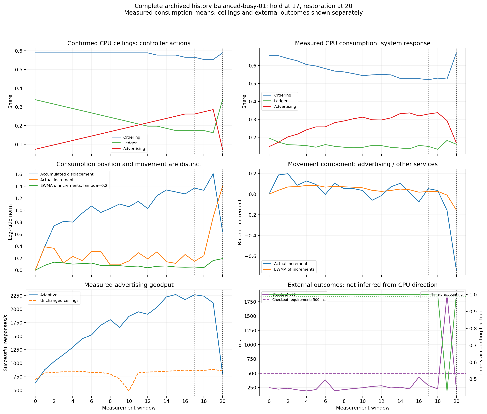
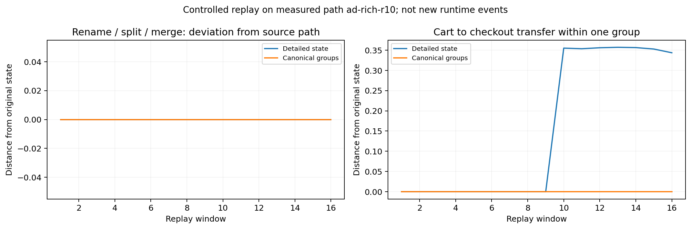

# Position, movement and component continuity — v0.1.0

This retrospective readout separates **where the relative resource state is**
from **how it is changing now**. It reuses saved runtime measurements; no new
application runs, fitted forecasts, alert thresholds or controller changes are
introduced. The original MEWMA model and its signal results are unchanged.

Read the [plain-language Russian interpretation](RESULTS_RU_v0.1.0.md),
[machine summary](results/v0.1.0/summary.json) and
[complete illustrated history](results/v0.1.0/full-history-v0.1.0.png).

## Procedure

1. Keep controller CPU ceilings `q(t)`, measured CPU consumption `u(t)` and
   external service outcomes separate. Normalize consumption to its eleven
   service shares: `x(t) = u(t) / sum(u(t))`. Retain total consumption separately.
2. Record three quantities for every window: displacement from the reference,
   the actual change since the preceding window, and an EWMA of those changes.
   Do the same for ceilings, without confusing an allocation action with the
   system's response.
3. Inspect every recorded hold and restoration, together with latency, errors,
   advertising goodput and accounting timeliness. Use all available windows,
   including the one early-terminated history; do not select successful episodes.
4. In the separate continuous-load archive, summarize how much of the observed
   path accumulates in a consistent direction, paired within each runner.
5. Separately replay controlled component rename/split/merge operations and
   within-group redistribution. These transformations are not new runtime events.

The reference is an observed baseline, **not a proof of stationarity or a fitted
safety boundary**. CPU ceilings are limits, not consumption or reserved capacity.

## Results and what they mean

| Evidence | Observed result | Interpretation |
| --- | --- | --- |
| Guarded adaptation: 24 runner pairs, 48 histories, 988 windows | Four adaptive holds have zero quota increment, but nonzero consumption increments (Aitchison norms 0.147–0.318). | No controller action does not imply a motionless runtime state. Accumulated displacement, actual movement and smoothing lag are different quantities. |
| Same archive: five quota restorations | Consumption moved closer to its reference in all five, without coinciding with it. The next recorded windows satisfied the original external requirements. | Returning ceilings does not restore exactly the original consumption composition. Observed service improvement is measured separately, not deduced from geometry. |
| Continuous load: 250 runner pairs, 500 histories, 8000 windows | Post-window-4 path coherence was higher under reallocation in 224/250 pairs; medians 0.160 versus 0.079. | Controlled adaptation more often accumulated coherent relative movement against runtime fluctuations. This is not a new alarm or safety score. |
| Controlled replay on 250 measured paths | Known lineage preserves detailed and canonical states under rename/split/merge, to numerical precision. | A component correspondence permits continuity across representation changes. Automatic lineage discovery is not tested. |
| Separate within-ordering replay | Moving 20% of cart consumption to checkout changes every detailed path, but leaves canonical group totals unchanged. | Group aggregation hides internal redistribution; retaining the detailed state is necessary to observe that change. |

For path coherence, the paired mean difference is 0.07860, with a descriptive
paired-bootstrap 95% interval [0.07095, 0.08641]. Histories, not individual windows,
are resampled as runner pairs (5000 draws, seed 2026101705). This is a retrospective summary, not a
preregistered success criterion or detector comparison.

### A complete measured history

The example `balanced-busy-01` was already named in the executed source design;
it is not a new outcome-based selection.



At window 17, transfers pause but the consumption composition still changes.
At window 19, checkout p95 is 1874.8 ms, accounting timeliness is 42.9%, and
advertising goodput is 2114.7/s versus 633.1/s at baseline. At window 20, ceilings
are restored; p95 is 220.6 ms, accounting timeliness is 100%, and advertising
goodput is 805.7/s. These are recorded trade-offs, not outcomes predicted from
the CPU vector. The source campaign starts/stops generators between windows:
this is **not** evidence of recovery under uninterrupted load.

All restoration episodes are retained in
[adaptation-events.csv](results/v0.1.0/adaptation-events.csv).

| Runner block | Restoration window | Checkout p95 before → after, ms | Consumption distance before → after |
| --- | ---: | ---: | ---: |
| balanced-busy-01 | 20 | 1874.8 → 220.6 | 1.608 → 0.645 |
| interactive-busy-01 | 7 | 609.3 → 127.8 | 1.016 → 0.435 |
| interactive-busy-02 | 13 | 3331.3 → 105.9 | 1.626 → 0.772 |
| interactive-busy-03 | 12 | 964.4 → 184.0 | 1.214 → 0.722 |
| interactive-busy-04 | 10 | 848.9 → 145.9 | 1.079 → 0.383 |

### Component continuity and aggregation



The canonical groups are ordering (frontend, cart, checkout, payment, currency,
shipping, product-catalog), ledger (accounting, kafka, astronomy-db) and
advertising (ad). The detailed channel retains all eleven semantic services.
The replay renames payment at window 5, splits accounting into 40/60 fragments
at windows 8–11 and merges at 12. Supplied lineage reconstructs both channels:
maximum errors are 2.72e-15 and 6.66e-16 respectively.

A separate 20% cart-to-checkout transfer from window 10 leaves group masses
unchanged, while detailed distance changes by 0.318–0.389. No SLO consequences
are attributed to these synthetic changes. Deliberately omitting accounting-b
lineage at window 8 blocks the readout in all 250 cases. Detecting plausible but
incorrect lineage, new semantic types and automatic lineage discovery is outside
this replay. Aggregation is not claimed to preserve all Aitchison distances.

## Definitions

Let `C` divide a positive vector by its sum, and let
`z(t) = CLR(x(t)) = log(x(t)) - mean(log(x(t)))`.

```text
d(t) = z(t) - z(reference)                 accumulated displacement
s(t) = z(t) - z(t-1)                       actual per-observation increment
v(t) = 0.2*s(t) + 0.8*v(t-1), v(initial)=0  smoothed increment
coherence = ||sum(s(t))|| / sum(||s(t)||)   windows 5–16, continuous archive only
```

CLR stores eleven entries constrained to sum to zero: ten degrees of freedom.
Its Euclidean vector norms equal Aitchison norms, or Euclidean norms in any
fixed orthonormal ILR basis. A zero vector has no direction; angles are null.
`1e-12` is a numerical zero tolerance, not an alert threshold. Nonpositive or
nonfinite consumption is rejected, not clipped or replaced.

With an explicit baseline window, the initial increment is zero. Continuous
histories begin after a separate measured reference interval, so their first
increment compares the first window with that reference. Vectors express change
**per observation, not per second**; window-center intervals are retained.
No calculation uses a future window. A stopped actual path has zero increments,
but EWMA continues decaying by a factor of 0.8: this is lag, not new movement.

The original MEWMA filters **reference/background deviations** and produces a
covariance-standardized signal statistic. This readout filters **increments**;
it does not reuse MEWMA signal limits. Ordinary share increments and their EWMA
are also retained: direction is not exclusive to log-ratio coordinates.

The optional `relative_readout_angle_degrees` applies the additive share-EWMA
step to the current composition, then expresses the implied finite change in
CLR, only when positive. It is a common geometric readout, not a new detector
or an independently measured correct direction.

## What the relative-scale check establishes

The observed multiplicative paths are re-expressed from four actual reference
compositions, one per context in the selected-input order. Relative filtered
increments agree within 3.93e-16. Additive share-EWMA directions differ across
these starts (median maximum pairwise angle 6.70 degrees). This verifies the
established proportional-scale property and implementation. It is **not** four
new runtime experiments, a new theorem, or evidence of equal SLO risk at those
starting states. See [the separate check](results/v0.1.0/relative-transport-not-runtime.csv).

## Inputs, coverage and provenance

- Guarded observations: the existing
  [source record](../../probe7/results/main-v0.2.0/block-level.json), run
  `38464142171`. All 988 windows and 48 histories remain. Control
  `ledger-busy-01` has only its baseline and stopped with
  `baseline_not_valid_and_safe`: there are 47 complete histories, not 24 complete
  pairs. Its failure is retained, not replaced.
- The 48 [native CPU streams](inputs/native/) reproduce every archived
  arithmetic rate mean, with maximum error 3.33e-16 CPU. Independent time
  integration gives 100% per-part interval coverage for all 988 windows and
  agrees on all five restoration distance reductions. Arithmetic rate means
  and integrated estimates are retained separately, never silently substituted.
- Continuous inputs: [250 compact paired records](inputs/continuous-selected.jsonl.gz),
  the [existing first-qualified selection](inputs/selected-cases.csv), the
  [273-attempt ledger](inputs/attempt-ledger.csv), and
  [original record hashes](inputs/continuous-provenance.json). They retain the
  source order and selection, without reselecting attempts. Selected sources
  contribute 230, 17 and 3 pairs from runs `38996401485`, `39018127810` and
  `39037712685`. Only fields needed for this descriptive replay are projected
  into the compact archive; original source hashes are provenance, not hashes
  of that projection. Window CPU values are the original integrated measurements.
- Native streams are copied byte-for-byte. The root checksum manifest covers
  all bundled inputs, outputs and scripts. Neither campaign adds new replications
  here, and their outcomes are not pooled.

## Files and reproduction

| File in [results/v0.1.0](results/v0.1.0/) | Content |
| --- | --- |
| [summary.json](results/v0.1.0/summary.json) | All aggregate counts, event details, coherence and replay summaries. |
| [adaptation-windows.csv](results/v0.1.0/adaptation-windows.csv) | All 988 windows: separate quota/consumption displacement, increments, EWMA, totals and external outcomes. |
| [adaptation-events.csv](results/v0.1.0/adaptation-events.csv) | Every adaptive hold and restoration, not a subset. |
| [adaptation-histories.json](results/v0.1.0/adaptation-histories.json) | All 48 histories, lengths, stops, failures and action counts. |
| [native-replay.csv](results/v0.1.0/native-replay.csv) | Native mean reconstruction, CPU integrals and coverage for every guarded window. |
| [continuous-windows.csv](results/v0.1.0/continuous-windows.csv) | All 8000 continuous-load windows and vectors. |
| [continuous-histories.csv](results/v0.1.0/continuous-histories.csv) | Per-history path lengths, displacement and coherence, 500 rows. |
| [structure-replay.csv](results/v0.1.0/structure-replay.csv) | All 4000 controlled structural replay windows and lineage gates. |
| [relative-transport-not-runtime.csv](results/v0.1.0/relative-transport-not-runtime.csv) | The separate mathematical scale check, 250 paths. |
| [adaptation-native-provenance.json](results/v0.1.0/adaptation-native-provenance.json), [source-provenance.json](results/v0.1.0/source-provenance.json) | Native stream hashes and original continuous-record provenance. |

From the repository root (Python 3.13):

```bash
python -m pip install -r drift-monitor/trajectory-observability/requirements.txt
python -B drift-monitor/trajectory-observability/scripts/analyze.py --output-dir artifacts/trajectory-observability-replay
python -B drift-monitor/trajectory-observability/scripts/check_replay.py --output-dir artifacts/trajectory-observability-replay
python -B -m unittest discover -s drift-monitor/trajectory-observability/tests -v
```

These commands start no services and use no network after dependencies are
installed. `--no-figures` skips rendering. Outputs go into ignored scratch space;
the CLI rejects overwriting committed inputs/results. Numerical and CSV/JSON
results can be compared with the archive; rendering bytes may vary by platform.
The numerical tests cover prefix-only computation, stop/lag/reversal, zero
handling, relative invariance, lineage reconstruction and all archived counts.
The root standard-library verifier additionally checks hashes, links, input
membership, output recurrences and summary consistency without NumPy installed.

This is evidence for descriptive trajectory observation and component
continuity. It does not establish a reliable SLO boundary, prospective warning
performance, causal failure mechanism or unique superiority over other
multivariate methods.
