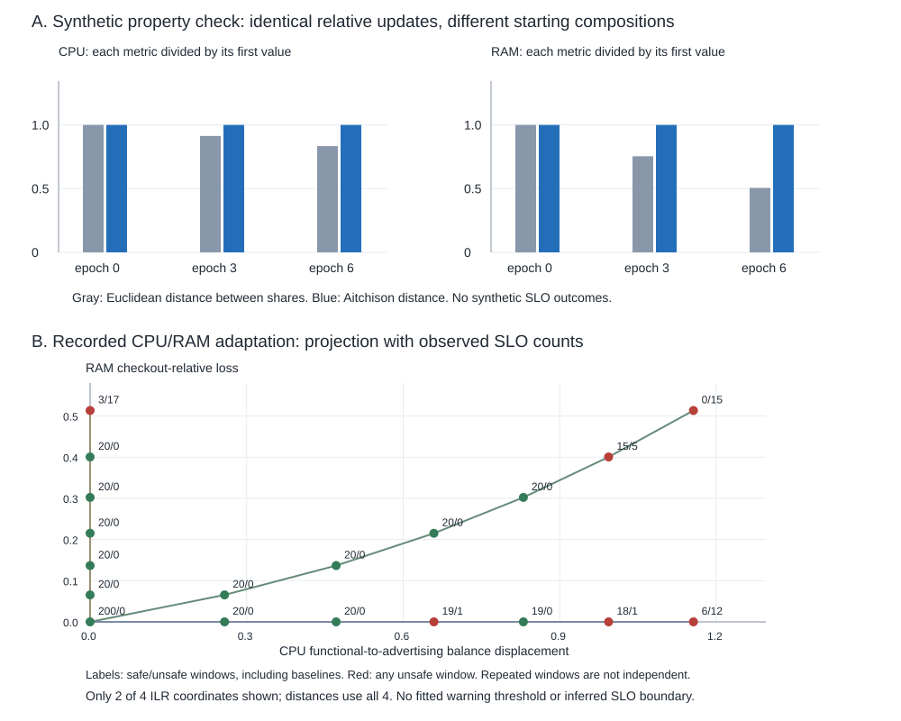

# Compositional geometry verification v0.1.0

This separate, lightweight analysis verifies a relative-drift representation
using saved allocations and externally measured outcomes. It starts no services,
adds no workload observations, fits no alert thresholds, and leaves the executed
runtime designs unchanged.

## What the check establishes

Positive configured allocations are represented separately for each closed
resource budget. CPU has four parts and three ILR coordinates; RAM has two parts
and one ILR coordinate. All coordinates are retained, rather than reducing the
state to one chosen balance.

For relative redistribution, Aitchison geometry measures changes in log-ratios.
The check demonstrates that the same multiplicative update has the same
full-vector displacement and distance at different initial compositions.
Common perturbation of both endpoints preserves the distance and displacement.
An orthonormal change of ILR basis preserves distances and angles. Euclidean
distance between shares does not have the same multiplicative invariance;
it remains a valid measure of additive share changes.

These are checks of known mathematical properties and their implementation,
not new empirical discoveries or a guarantee of better SLO classification.
Changing CPU units or RAM units preserves both closed shares and log-ratios;
unit conversion is not claimed as an advantage over already normalized shares.
Subcomposition dominance is checked, not equality of all reduced distances.

## Two explicitly separate evidence types

1. Synthetic property checks use three recorded allocations as starting points
   and the fixed factors in [design-v0.1.0.json](design-v0.1.0.json). Transformed
   allocations have no SLO labels. Their resource totals are closed again; they
   are not additional executed conditions or unchanged physical capacities.
2. Observed trajectories use every saved window from [CPU migration](../probe5/results/)
   and [CPU/RAM adaptation](../probe6/results/). Original labels and validity flags
   are retained, stopped trajectories are not extended, and the series are not
   pooled. The geometry is linked to the observed allocation and SLO, not used to
   invent a distance to a known failure boundary.

CPU coordinates, in order, are functional services versus advertising, checkout
versus payment/shipping, and payment versus shipping. RAM uses checkout versus
advertising. The state is the product of separate composition spaces, not a
composition obtained by adding CPU and memory bytes.

The product metric uses explicitly fixed CPU=1 and RAM=1 weights on squared
ILR distances. CoDA does not uniquely choose the weights, establish statistical
independence between resources, or imply that equal geometric displacements have
equal performance effects. Capacity totals and workloads remain part of the
operational context. A two-coordinate figure is a projection, not the full metric.

## Reproduction

Run `compositional-geometry` in GitHub Actions with `expected_sha` set to the exact
analysis commit. One job checks fixed source hashes, runs the tests, and produces:

- `metric-properties.csv`: six synthetic CPU/RAM property checks, no SLO labels;
- `trajectory-coordinates.csv`: full coordinates and unchanged observed outcomes;
- `summary.json`: numerical checks, separate source counts and execution provenance;
- `geometry.svg`: metric consistency and a projected view of actual outcomes;
- `RESULTS.md`: interpretation and limitations.

Actions artifacts are retained for 90 days; the completed output is additionally
archived in this directory so review need not depend on artifact expiry.
Source checksums use LF text bytes as stored in Git.

## Completed result

The completed [interpretation and table](results/v0.1.0/RESULTS.md),
[full observed coordinates](results/v0.1.0/trajectory-coordinates.csv),
[synthetic checks](results/v0.1.0/metric-properties.csv),
[machine-readable verification](results/v0.1.0/summary.json), and
[figure](results/v0.1.0/geometry.svg) are archived together.
The two source series contribute 594 CPU-migration windows and 551 CPU/RAM
windows, kept separate. All six synthetic checks remain unlabeled.

For an identical relative update across the three starting compositions,
Aitchison distance is constant: CPU 0.790041, RAM 0.776836. Euclidean share
distance varies: CPU 0.130375--0.156347, RAM 0.029149--0.057645.
The maximum observed distance/angle verification error is below 1.4e-15.
This is geometric consistency for relative drift, not evidence that unchanged
SLO risks can be transported to new allocations.



Local lightweight check:

```bash
python -B -m unittest discover -s geometry/tests -v
```
