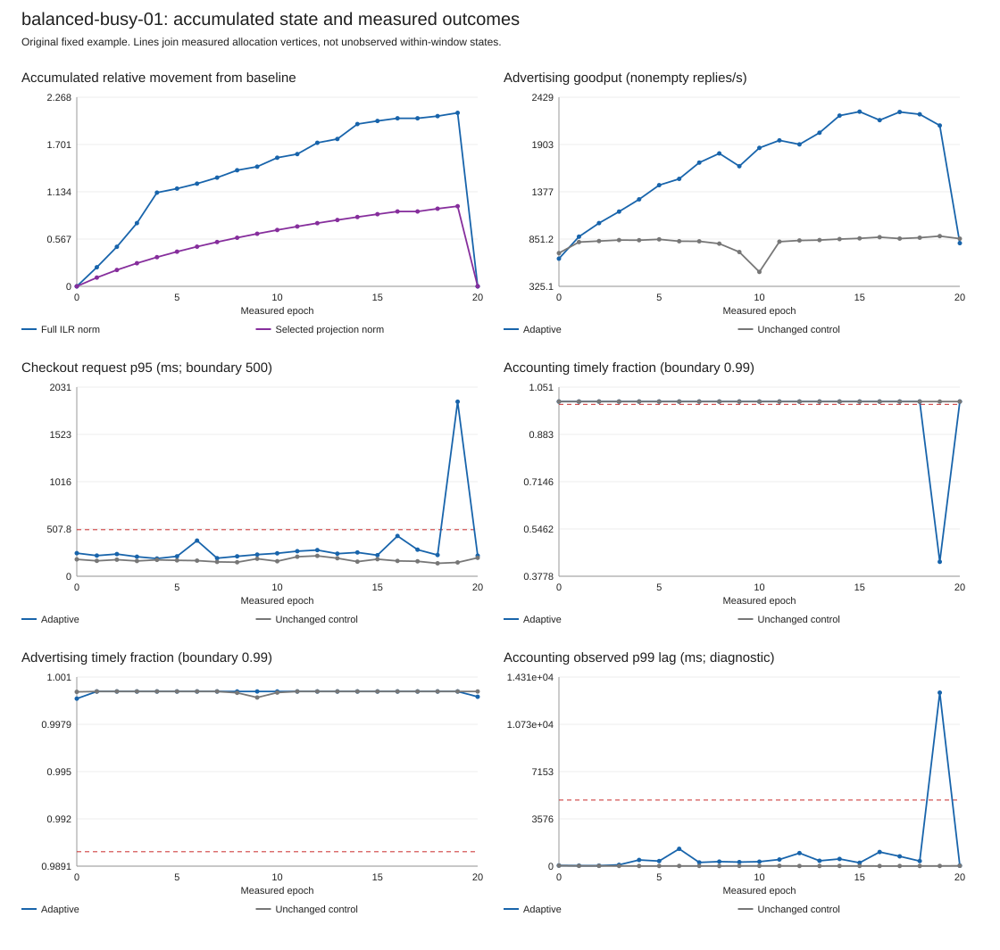
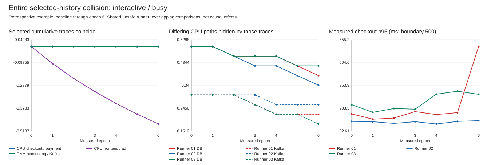

# Accumulated relative adaptation: saved-data results

Retrospective analysis of the existing campaign; no new workloads or altered SLO labels.

All 24/24 runner pairs, 48 attempted histories and 988 windows are retained.
Complete baseline-safe fixed-endpoint pairs: 23.

## 1. Full accumulated history and external requirements

Every measured state is referenced to its own baseline; all twenty displacement coordinates are preserved.
The full norm and its three-coordinate projection share relative-geometric units. Raw-share distances use different scales and are not overlaid.
Positive margin means measured slack before the stated requirement, not reserved resource capacity; error-rate membership is strictly below 1%.
Accounting observed-p99 margin is diagnostic and conditional on observed commits, not a replacement for the timely fraction.

| Fixed cycle-20 control-adjusted quantity | Pairs | Median change | Pair-bootstrap median interval |
| --- | ---: | ---: | --- |
| advertising_goodput | 23 | 2105.3500 | [1607.0666666666666, 2675.1666666666665] |
| checkout_latency_margin_ms | 23 | -45.8367 | [-66.9098229, -14.451987400000178] |
| checkout_error_margin_pp | 23 | 0.0000 | [0.0, 0.0] |
| advertising_timely_margin_pp | 23 | 0.0000 | [-0.0007771236305242901, 0.006241807627493934] |
| accounting_timely_margin_pp | 23 | 0.0000 | [0.0, 0.0] |
| accounting_observed_p99_margin_ms | 23 | -55.4115 | [-124.98261718749927, -51.221401367186445] |

Metrics retain their own physical units; a recipient gain never compensates for another violated requirement.
Intervals resample complete runner pairs, not windows. They describe these designed contexts, not production reliability.
The controller command path also records rollbacks between measured windows. An applied state without a subsequent window receives no inferred SLO.
Unmeasured post-rollback adaptive endpoints: 2.

## 2. What entire selected local traces hide

Equal selected endpoint coordinates produced 5 overlapping safe/unsafe comparisons.
Equality at every epoch from baseline through a common prefix produced 2 overlapping comparisons, involving unsafe histories ['interactive-busy-01'].
These are descriptive witnesses of projection loss, not independent replications or causal effects.
Full raw shares and full ILR both retain the differing allocation paths. Neither alone determines the SLO outcome.
Median of per-adaptive-history median cumulative displacement energy outside the selected projection: 0.7811.
This is geometric information loss, not a missed-alarm percentage.

| Unsafe runner / epoch | Safe runner / epoch | Checkout p95 unsafe / safe (ms) | DB CPU unsafe / safe | Kafka CPU unsafe / safe |
| --- | --- | --- | --- | --- |
| interactive-busy-01 / 6 | interactive-busy-02 / 6 | 609.25 / 120.49 | 0.38 / 0.34 | 0.22 / 0.26 |
| interactive-busy-01 / 6 | interactive-busy-03 / 6 | 609.25 / 294.01 | 0.38 / 0.42 | 0.22 / 0.18 |

All three selected coordinate traces coincide over each entire prefix, not merely at the displayed endpoint.
Runner noise, differing hidden state and different preceding full allocations are not eliminated by this retrospective comparison.

## 3. Actual equal additive transfers, different relative movement

All examples are first transfers at moderate load in repetition 1; they were selected retrospectively for illustration.

| Initial context | Accounting CPU before/after | Accounting relative loss | Raw-share norm | Aitchison/ILR norm | Measured safe |
| --- | --- | ---: | ---: | ---: | --- |
| ledger-moderate-01 | 0.35 / 0.31 | 11.43% | 0.01664 | 0.19155 | True |
| balanced-moderate-01 | 0.25 / 0.21 | 16.00% | 0.01664 | 0.22884 | True |
| interactive-moderate-01 | 0.15 / 0.11 | 26.67% | 0.01664 | 0.34036 | True |

Each transfers 0.04 CPU from accounting to advertising (0.25 to 0.29), under the same 3.4-CPU budget.
The complete additive displacement vector is identical; relative losses and complete ILR vectors differ.
The starting composition plus the raw change also permits recovering this difference. CoDA supplies a systematic relative representation, not new data.
A larger relative displacement is not asserted to cause a larger SLO risk. These three examples were all safe.

## 4. Known geometric property, explicitly separate from runtime evidence

The multiplier from the balanced example is applied and closed at every example's initial composition.
These transformed endpoints were not executed and have no SLO labels.
For the same positive relative perturbation, full ILR displacement is invariant to the starting composition; raw-share displacement need not be.
This verifies an established identity in this implementation, not a new theorem or a prediction guarantee.
Inverse, relative-identity and accumulated-vector checks: {'inverse_shares_max': 1.6653345369377348e-16, 'relative_identity_max': 1.359173279113534e-15, 'telescoping_max': 7.021666937153402e-16}.

## 5. Consequence analogy remains an additional, non-superior result

The original analogy errors are retained unchanged. A newly added no-headroom-change diagnostic is reported separately.

| Method | Macro pair mean absolute error | Median nearest runner pairs |
| --- | ---: | ---: |
| posthoc_no_headroom_change | 0.2691 | None |
| selected_log_ratios | 0.4312 | 10.0 |
| euclidean_share_change | 0.3860 | 11.0 |
| full_ilr_change | 0.4120 | 2.0 |

Lower is better in this particular headroom-change task. These are not alerting error rates.
The constant no-change diagnostic performs better than all three analogy procedures in this aggregate error.
Tie-induced averaging uses many more neighboring runner pairs for raw shares than for ILR; the comparison does not isolate geometry from smoothing.
Similarity uses one-step displacements without the full starting allocation or internal queue state. It is not a test of complete-history prediction.
No ILR predictive superiority is inferred or substituted for the accumulated-history results.

## Scope and reproducibility

Only CPU moves within these histories. RAM remains a differing initial context; twenty state coordinates do not imply twenty exercised directions.
Closed configured ceilings are not reserved or consumed resources. Loads, absolute budgets and runtime history remain context.
Vector accumulation and inversion are mathematical/implementation checks. Runtime trade-offs and hidden selected traces are separate empirical observations.
Observed-vertex and command-vertex path lengths refer to discrete settled allocation vertices, not unobserved continuous kernel-update trajectories.

[All cumulative windows](history-windows.csv), [every trajectory](trajectory-level.csv), [paired epochs](paired-epochs.csv).
[All prefix witnesses](prefix-witnesses.csv), [their complete prefixes](prefix-witness-history.csv), [endpoint witnesses](endpoint-witnesses.csv).
[Actual transfers](actual-transfer-examples.csv), [unexecuted property checks](relative-update-checks.csv), [secondary diagnostics](secondary-diagnostics.csv).
[Machine-readable summary](summary.json). All original primary observations remain in the separate main archive.
