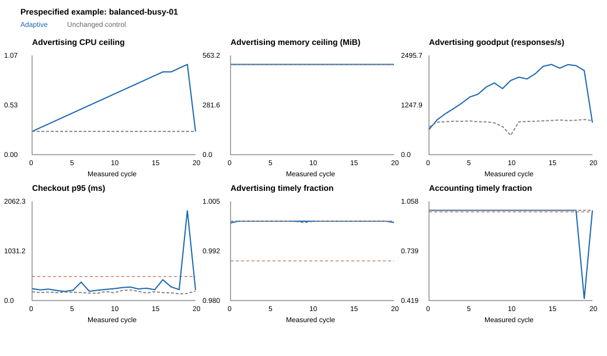

# Guarded adaptation: recorded results

Main observations only. Technical pilot data are never pooled.

Received 24/24 pairs; complete fixed-endpoint pairs: 23.
Missing pairs: [].
Proposed transfers: 470; rollbacks: 8.
Resource counts: {'cpu': 470, 'memory': 0}.
Observed donors: ['accounting', 'astronomy-db', 'checkout', 'currency', 'kafka', 'product-catalog', 'shipping'].

## Fixed-endpoint trade-offs

Contrasts subtract each history's baseline and then its matched unchanged control at cycle 20.
They retain failed endpoints and are not chosen at a favorable or first-crossing step.

| Metric | Pairs | Median adjusted change | Range | Positive / negative pairs |
| --- | ---: | ---: | --- | --- |
| goodput | 23 | 2105.3500000000004 | 11.833333333333371 to 4853.466666666666 | 23 / 0 |
| checkout_p95_ms | 23 | 45.83668585000001 | -43.64639455000014 to 4884.3096384499995 | 21 / 2 |
| checkout_error_fraction | 23 | 0.0 | -0.001388888888888889 to 0.20833333333333334 | 1 / 3 |
| ad_timely_fraction | 23 | 0.0 | -0.0006241311810264438 to 0.0003812622321632819 | 11 / 8 |
| accounting_timely_fraction | 23 | 0.0 | -0.7821052631578946 to 0.0 | 0 / 2 |
| accounting_observed_p99_lag_ms | 23 | 55.41152832031229 | -12.646914062500016 to 18681.937746582033 | 21 / 2 |

Accounting p99 lag is conditional on observed commits; its timely-fraction outcome retains missing orders.

## Representation comparison

Each query excludes its complete runner pair; workload profile and both endpoint-window lengths match.
Targets are nonzero consecutive observed reallocations. All methods use identical targets and candidates.
Equidistant nearest sections are averaged within each neighboring pair, then equally across pairs.
Error is the mean absolute difference between observed changes in the three normalized controller headrooms.
These headrooms are descriptive policy signals, not a learned safe-region metric.

| Representation | Query pairs | Macro pair mean absolute error | Pair-bootstrap 95% interval |
| --- | ---: | ---: | --- |
| selected_log_ratios | 24 | 0.431153176509624 | [0.20127243761958646, 0.6833621763284743] |
| euclidean_share_change | 24 | 0.38600598758050947 | [0.1793791550426076, 0.6401273403360402] |
| full_ilr_change | 24 | 0.4119745245962941 | [0.1488547681015792, 0.7365480457518234] |

Individual processes are not interchangeable:

| Representation | Checkout error | Advertising error | Accounting error |
| --- | ---: | ---: | ---: |
| selected_log_ratios | 0.23169078319588116 | 0.013148285739601638 | 1.048620460593389 |
| euclidean_share_change | 0.1895612565919593 | 0.016819833049763713 | 0.9516368730998054 |
| full_ilr_change | 0.21624229880821172 | 0.016930239400584943 | 1.0027510355800857 |

Raw-minus-ILR mean error: {'mean': -0.025968537015784596, 'bootstrap_pair_mean_95': [-0.23253409737881722, 0.11038840765091677], 'positive_pairs': 9, 'negative_pairs': 15}.
Positive means lower ILR error; negative means lower raw-share error. Neither is required.

Observed ILR displacement linear span: 8/20.
Linear span is not intrinsic controller dimension or coverage of the full state space.
Median displacement energy outside the three fixed local contrasts: 0.8870180108589756.

## Inference scope

Closed configured ceilings are not reservations. Baseline-invalid and short histories remain visible.
All unsafe windows and rollbacks are retained. A successful guard may prevent every violation.
Full raw shares and full ILR retain the same allocation information; their similarity metrics differ.
Projection loss and downstream analog retrieval are separate questions.
Outcome similarity remains conditional on these loads, budgets, histories and controller.
Resampling uses runner pairs, never dependent windows as independent replications.
Intervals describe pair-resampling of the fixed retrieval results, conditional on this neighbor pool; they are not calibrated generalization guarantees.
Analysis 0.1.1 additionally matches the preceding-window duration: 60-to-30-second first transitions are not pooled with 30-to-30-second later transitions. This eligibility correction changes no runtime observations or controller decisions.

All windows: windows.csv. Every matched epoch: paired-epochs.csv.
All retrieved analogs and errors: neighbors.csv and pair-retrieval-errors.csv.
Complete readable block records and validity: block-level.json.
